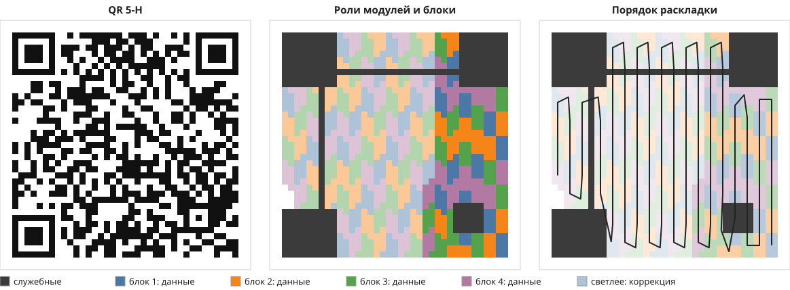
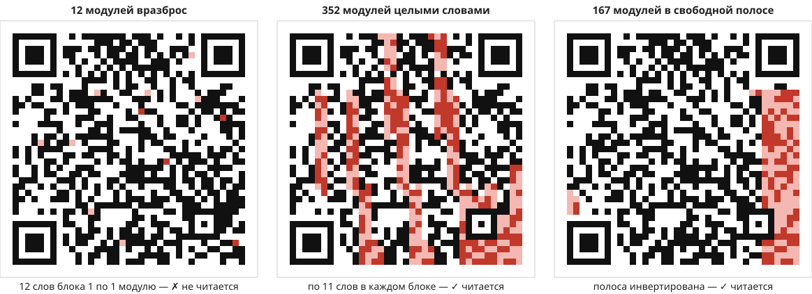
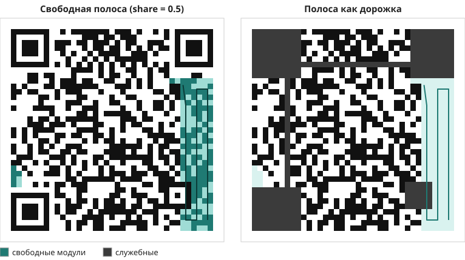

# Какие модули QR можно менять

Коротко:

- Служебные модули (локаторы, timing, format/version info) трогать нельзя.
- Бюджет ошибок считается в **кодовых словах по блокам**, а не в модулях: блок восстанавливает до `t` испорченных слов, и неважно, испорчен в слове 1 модуль или все 8.
- Поэтому портить выгодно целыми словами. Для нас это «свободная полоса» — непрерывная дорожка модулей, которые анимация может менять как угодно.

Код: [`src/qr/layout.ts`](../../src/qr/layout.ts). Картинки генерирует `node research/qr-layout/render.ts`.

## Как устроен QR



- Модули данных собраны в кодовые слова по 8 бит. Слова уложены змейкой: пары столбцов снизу вверх, потом сверху вниз, начиная с правого нижнего угла.
- Слова разбиты на блоки. У каждого блока свой Reed–Solomon: `dataCodewords` данных и `ecCodewords` коррекции.
- Блоки перемешаны (interleaving): подряд идущие слова принадлежат блокам 1, 2, 3, 4, 1, 2… Поэтому соседние слова разного цвета.
- Блок исправляет `t = ⌊(ecCodewords − p) / 2⌋` слов. `p` — небольшая защита от ложного декодирования, она бывает только у версий 1–3.

## Бюджет ошибок



Красные модули перевёрнуты. Вердикт выносит zxing.

- **Слева.** 12 модулей, но каждый попал в своё слово одного блока. Это 12 слов при `t = 11`, и QR не читается.
- **В центре.** 352 модуля, но они собраны в 11 целых слов в каждом блоке. Это ровно `t`, и QR читается.
- **Справа.** Свободная полоса, которую мы используем: половина бюджета, запас на камеру.

Бюджеты для `https://github.com/firelion9/dynamic-qr`. В таблице минимальная версия и версия на 1 больше:

| Уровень | Версия | Блоки × t | Целыми словами | Вразброс | Свободная полоса |
|---|---|---|---|---|---|
| L | 3 (29×29) | 1 × 7 | 56 (10%) | 7 (1%) | 31 |
| L | 4 (33×33) | 1 × 10 | 80 (10%) | 10 (1%) | 47 |
| M | 3 (29×29) | 1 × 13 | 104 (18%) | 13 (2%) | 55 |
| M | 4 (33×33) | 2 × 9 | 144 (18%) | 18 (2%) | 71 |
| Q | 4 (33×33) | 2 × 13 | 208 (26%) | 26 (3%) | 103 |
| Q | 5 (37×37) | 4 × 9 | 288 (27%) | 36 (3%) | 135 |
| H | 5 (37×37) | 4 × 11 | 352 (33%) | 44 (4%) | 167 |
| H | 6 (41×41) | 4 × 14 | 448 (32%) | 56 (4%) | 231 |

Проценты считаются от модулей данных. По умолчанию мы кодируем с уровнем H.

**Правило для анимаций:** в каждом кадре в каждом блоке испорчено не больше `share · t` слов, где `share = 0.5`. Вторая половина бюджета — запас на блюр, блики и неровную съёмку. zxing на чистой картинке выдержит и `t`, а телефон с экрана уже нет.

Менять оттенок, сохраняя яркость, можно бесплатно: сканер смотрит только на светлое/тёмное.

## Можно ли инвертировать целую область

Можно, но не «30% где угодно». 30% — это доля кодовых слов, и только при равномерной порче по блокам. У сплошной области края задевают слова частично, а это всё равно целое слово. Служебные модули внутри области не трогаем.

Самые большие области в центре v5-H, которые проходят `fitsBudget`:

| Форма | Без запаса (`share = 1`) | С запасом (`share = 0.5`) |
|---|---|---|
| квадрат | 15×15 | 10×10 |
| вертикальная | 8×32 | 5×20 |
| горизонтальная | 29×7 | 17×4 |

Без запаса это точный предел: 15×15 zxing читает, 16×16 уже нет. Вертикальные области дешевле, потому что слова — вертикальные прямоугольники 2×4.

Любую фигуру можно проверить так: `fitsBudget(layout, changed, share)`.

## Маски

Маска — это XOR одного из 8 фиксированных узоров поверх данных. Она нужна, чтобы не было больших пятен и ложных локаторов. Декодер читает номер маски из format info, поэтому годится любая из 8. Свободы маска не добавляет: что можно менять, определяется положением модуля в слове/блоке, а не его цветом.

## Свободная полоса



Подряд идущие по раскладке слова из-за interleaving делятся между блоками поровну. Поэтому мы берём их с начала раскладки, пока не кончится бюджет `share · t` у какого-то блока. Физически это дорожка шириной в две пары столбцов у правого края QR. Внутри неё можно рисовать что угодно, например «чистую» дорожку для змейки или пакмана.

Туда же попадают remainder-биты (0–7 модулей вне слов, слева внизу на картинке): они вообще ничего не кодируют.

Для v5-H свободно 167 модулей, для v6-H — 231. Если нужно больше места, берём версию на 1–2 больше: `encodeQr(text, 'H', minVersion)`.

## Как пользоваться

`qrDataToBuffers` пишет в вершинные атрибуты:

| Атрибут | Значение |
|---|---|
| `flags & 1` | модуль тёмный |
| `flags & 2` | служебный, не трогать |
| `flags & 4` | в свободной полосе, можно менять как угодно |
| `@location(3) codeword: u32` | номер кодового слова в порядке раскладки, `0xffffffff` вне слов |

Модули с одинаковым `codeword` лучше менять вместе: 8 модулей стоят столько же, сколько один.

Из TypeScript:

```ts
const layout = qrLayout(matrix);    // version, ecLevel, reserved, codeword, codewordBlock, blocks
const free = freeModules(layout);   // boolean[][], share = 0.5 по умолчанию
fitsBudget(layout, changed);        // влезает ли маска изменённых модулей в бюджет
```

Версия и уровень коррекции читаются из самой матрицы (размер и format info), поэтому всё одинаково работает и для `encodeQr`, и для `decodeQr`.

## Как проверено

Тесты в [`layout.test.ts`](../../src/qr/layout.test.ts) гоняют zxing на всех уровнях L/M/Q/H:

- `t` испорченных слов в каждом блоке → QR читается;
- `t + 1` слово в одном блоке → не читается;
- по одному модулю в `t + 1` словах → тоже не читается;
- вся свободная полоса инвертирована → читается.

Тесты ловят ошибки в раскладке, interleaving и расчёте `t`. Это проверено ручной порчей кода.

## Что дальше

- Змейка: цикл по свободной полосе.
- Проверка читаемости анимаций: рендер кадров вне экрана → `decodeQr` → процент читаемых кадров.
- Если останется время, QArt-подход: подбирать padding так, чтобы нужный рисунок получался без единой ошибки. На H свободных байт почти нет, поэтому нужен уровень пониже или версия побольше.

## Источники

- ISO/IEC 18004:2015 — спецификация QR.
- [Thonky QR Code Tutorial](https://www.thonky.com/qr-code-tutorial/): структура, блоки, раскладка.
- [Russ Cox, QArt Codes](https://research.swtch.com/qart).
